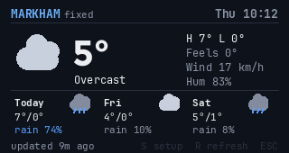
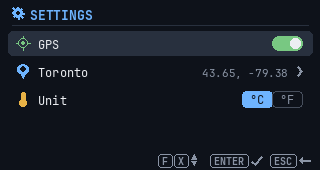
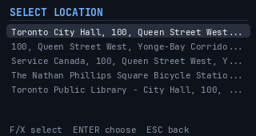

# Weather for CardputerZero

Current weather and a 3-day forecast on the M5Stack CardputerZero's 320x170 screen. Data comes from [Open-Meteo](https://open-meteo.com/) (no API key needed) and refreshes every 15 minutes.



## Location

- Uses the Cap LoRa-1262 GPS when it is enabled and has a fix.
- Otherwise uses a fixed place you search for in Settings (geocoding by OpenStreetMap Nominatim). Default: Toronto.

 

## Keys

| Screen | Key | Action |
|--------|-----|--------|
| Main | S | Settings |
| Main | R | Refresh |
| Main | Hold ESC 3 s | Exit (a bar shows the countdown; let go to cancel) |
| Settings | F / X | Move up / down |
| Settings | ENTER | Toggle GPS / search / choose / switch °C-°F |
| Settings | ESC | Back |

## Install

From the CardputerZero AppStore (share code `WTHR`), or build the package yourself on the device:

```sh
sh build-deb.sh "Your Name <you@example.com>"
sudo dpkg -i zero-weather_1.0.3_all.deb
```

For development, copy this folder to `~/zero-weather` on the device and run `sudo sh ~/zero-weather/install.sh` to register it with the launcher.

Requires `python3`, `python3-pil` and `python3-numpy`.

## Development

```sh
python3 -m unittest test_zero_weather
python3 zero_weather.py --preview out.png              # render one frame
python3 zero_weather.py --preview out.png --settings   # render settings screens
```

Settings are stored in `~/.config/zero-weather.json`; the last forecast is cached in `~/.local/share/zero-weather/weather.json`.

## License

MIT
